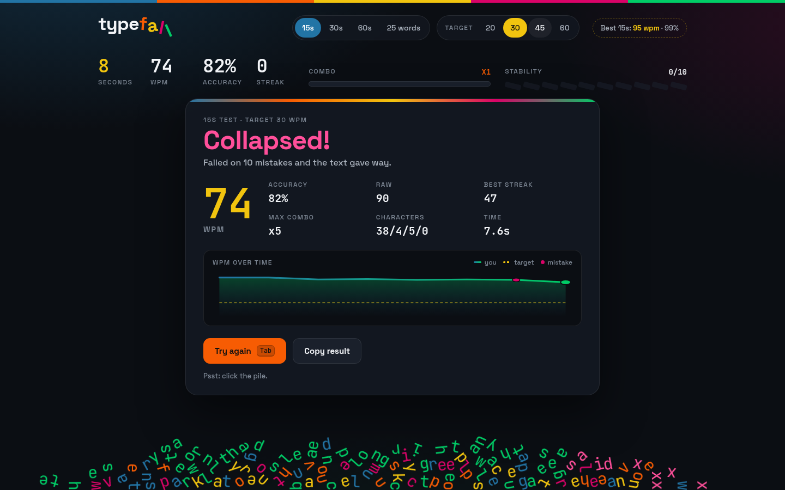

# Typefall

**The typing test where failure has gravity.** Hit your target and you get confetti. Miss it and every letter on screen falls, tumbles and piles up on an invisible floor at the bottom of the window.



## How to play

- Pick a length: **15s, 30s, 60s** or **25 words**, and a **target speed** (20, 30, 45 or 60 WPM).
- Start typing. The clock starts on your first key. Space moves to the next word, Backspace fixes the current one.
- **Pass:** finish with at least the target WPM **and** at least 90% accuracy.
- **Fail (the text falls):**
  - you finish under the target WPM, or
  - you finish under 90% accuracy, or
  - you make **10 mistakes** at any point. That collapses the text right away. The *Stability* meter shows how many you have left.

A mistake is any wrong or extra character, plus a space typed on a word that isn't right yet. Accuracy is correct keystrokes divided by all keystrokes. WPM is net: correctly typed characters (with their spaces) / 5 / minutes.

## Features

- Live WPM, accuracy, streak and a combo meter (x1 to x5, one level every 10 correct keys in a row).
- Correct letters pop in emerald, wrong letters shake in berry, and the text wobbles when you're down to 3 lives.
- Real physics on failure ([matter-js](https://brm.io/matter-js/), vendored in `vendor/`). After a fall, click or tap the pile to knock letters around.
- Confetti in the palette colours when you pass.
- A results card with WPM, raw WPM, accuracy, best streak, max combo, a character breakdown and a WPM-over-time sparkline with your mistakes marked.
- Personal best for each mode, saved in `localStorage` (passed runs only).
- Shortcuts: <kbd>Tab</kbd> new test, <kbd>Esc</kbd> same words again, <kbd>Shift</kbd>+<kbd>Tab</kbd> leaves the text box.
- Mobile: tap the text to bring up the keyboard (a hidden input handles typing).
- `prefers-reduced-motion`: no shaking, wobble or confetti, and the failure fall is a simple straight drop with no spin or bounce.

## Palette

| Rich Cerulean | Blaze Orange | Bright Amber | Berry Lipstick | Emerald |
|---|---|---|---|---|
| `#2274A5` | `#F75C03` | `#F1C40F` | `#D90368` | `#00CC66` |

## Run locally

It's static HTML, CSS and JS with no build step.

```bash
python3 -m http.server 8000   # then open http://localhost:8000
```

## Deploy (Netlify)

`netlify.toml` publishes the repo root (`publish = "."`) with no build command. In Netlify: **Add new site → Import an existing project → GitHub → typefall**, and keep the defaults.

After the first deploy, change the `og:image` / `twitter:image` meta tags in `index.html` to the absolute URL (for example `https://<your-site>.netlify.app/og.png`). Some social networks ignore relative image URLs.

## Tests

`tests/e2e.py` uses Playwright with headless Chrome. It plays a passing 15s run, a 10-mistake collapse, a too-slow 25-word run, a 390px mobile run and a reduced-motion run. It checks the outcomes, that the fallen letters stay in the viewport, the frame rate during the fall and that there are no console errors. Screenshots go to `screenshots/`.

```bash
pip install playwright && python3 tests/e2e.py   # CHROME=/path/to/chrome to override
```

## Credits

Made by [Nebula Digital](https://nebula-digital.com). Physics by matter-js (MIT, © Liam Brummitt). Fonts: Space Grotesk and JetBrains Mono (Google Fonts, OFL).
